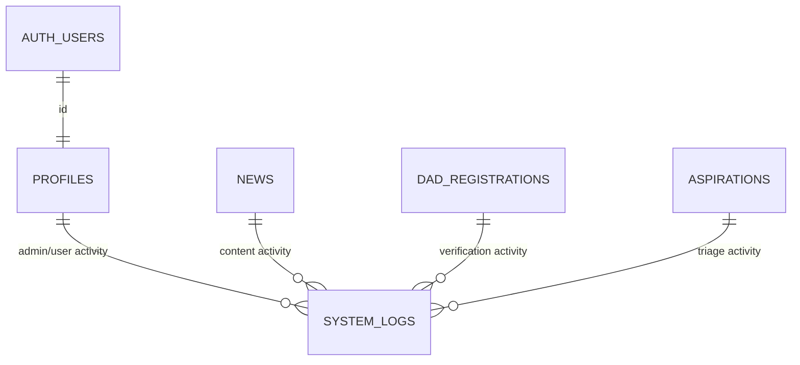

# Database Design

Dokumen ini diturunkan dari pemakaian tabel/field Supabase di source code.

## 1. Teknologi Database
- Backend data: **Supabase Postgres** (melalui `@supabase/supabase-js` dan `@supabase/ssr`).
- Storage object: Supabase Storage buckets.

## 2. Catatan Keterbatasan
- File migration/schema SQL tidak ditemukan di repository.
- Constraint detail, index, FK aktual, enum DB, dan RLS policy: **Tidak ditemukan di repository** (perlu konfirmasi langsung dari project Supabase).

## 3. Tabel yang Terobservasi

## 3.1 `profiles`
Dipakai untuk role pengguna dashboard.

| Field | Tipe (inferensi) | Keterangan |
|---|---|---|
| id | uuid/text | disamakan dengan `auth.users.id` |
| email | text | dipakai sorting pada `/api/users` |
| role | text | role dashboard (`admin`, `superadmin`, dll) |
| is_active | boolean | dipakai di UI users table |

Sumber: `src/app/api/users/route.ts`, `src/app/(admin)/dashboard/users/page.tsx`, `src/app/login/page.tsx`.

## 3.2 `news`

| Field | Tipe (inferensi) |
|---|---|
| id | number/integer |
| title | text |
| excerpt | text |
| content | text |
| category | text |
| date | text |
| publish_date | text/timestamp |
| cover | text/url |
| gallery | text[]/json array |
| status | text (`draft` / `published`) |
| pwmu_url | text/url |
| created_at | timestamp |
| updated_at | timestamp |

Sumber: `src/app/(admin)/dashboard/berita/page.tsx`, `src/app/(public)/berita/page.tsx`, `src/app/(public)/berita/[id]/page.tsx`, `src/app/(admin)/dashboard/page.tsx`.

## 3.3 `agendas`

| Field | Tipe (inferensi) |
|---|---|
| id | uuid/text |
| title | text |
| date | text |
| month | text |
| location | text |
| time | text |
| image_url | text/url |
| created_at | timestamp |

Sumber: `src/app/(admin)/dashboard/agenda/page.tsx`, `src/app/(public)/page.tsx`.

## 3.4 `pengurus`

| Field | Tipe (inferensi) |
|---|---|
| id | uuid/text |
| name | text |
| position | text |
| division | text |
| is_leader | boolean |
| photo | text/url |
| created_at | timestamp |

Sumber: `src/app/(admin)/dashboard/kepengurusan/page.tsx`, `src/app/(public)/kepengurusan/page.tsx`, `src/app/(public)/page.tsx`.

## 3.5 `divisions`

| Field | Tipe (inferensi) |
|---|---|
| id | uuid/text |
| name | text |
| description | text |
| color | text |
| photo | text/url |
| created_at | timestamp |

Sumber: `src/app/(admin)/dashboard/bidang/page.tsx`, `src/app/(public)/bidang/page.tsx`.

## 3.6 `alumni`

| Field | Tipe (inferensi) |
|---|---|
| id | uuid/text |
| name | text |
| batch | text |
| role | text |
| achievement | text |
| bio | text |
| photo | text/url |
| created_at | timestamp |

Sumber: `src/app/(admin)/dashboard/alumni/page.tsx`, `src/app/(public)/alumni/page.tsx`, `src/app/(admin)/dashboard/page.tsx`.

## 3.7 `products`

| Field | Tipe (inferensi) |
|---|---|
| id | uuid/text |
| name | text |
| description | text |
| price | number |
| category | text |
| available | boolean |
| image | text/url |
| is_preorder | boolean |
| po_duration | text |
| dp_amount | number |
| created_at | timestamp |

Sumber: `src/app/(admin)/dashboard/ekowir/page.tsx`, `src/app/kaizen-company/page.tsx`, `src/app/(admin)/dashboard/page.tsx`.

## 3.8 `aspirations`

| Field | Tipe (inferensi) |
|---|---|
| id | uuid/text/number |
| nama | text |
| kategori | text |
| pesan | text |
| status | text |
| admin_note | text |
| created_at | timestamp |

Sumber: `src/app/(public)/aspirasi/page.tsx`, `src/app/(admin)/dashboard/aspirasi/page.tsx`.

Catatan: nilai status tidak konsisten antara form publik (`unread`) dan dashboard admin (`pending/process/resolved`).

## 3.9 `dad_registrations`

| Field | Tipe (inferensi) |
|---|---|
| id | uuid/text |
| nama_lengkap | text |
| asal | text |
| tempat_tanggal_lahir | text |
| domisili | text |
| asal_komisariat | text |
| prodi | text |
| status | text (`pending` / `verified` / `rejected`) |
| created_at | timestamp |

Sumber: `src/app/(public)/daftar-dad/page.tsx`, `src/app/(admin)/dashboard/daftar-dad/page.tsx`.

## 3.10 `site_settings`

| Field | Tipe (inferensi) | Keterangan |
|---|---|---|
| key | text | contoh: `is_dad_open` |
| value | boolean/any | dipakai sebagai status buka/tutup DAD |

Sumber: `src/app/(public)/daftar-dad/page.tsx`, `src/app/(admin)/dashboard/daftar-dad/page.tsx`.

## 3.11 `organization_profile`

| Field | Tipe (inferensi) |
|---|---|
| id | integer (dipakai nilai 1) |
| name | text |
| short_name | text |
| founded | text/number |
| description | text |
| address | text |
| email | text |
| instagram | text |
| whatsapp | text |
| logo_url | text/url |
| updated_at | timestamp |

Sumber: `src/app/(admin)/dashboard/organisasi/page.tsx`, `src/app/(public)/kontak/page.tsx`.

## 3.12 `system_logs`

| Field | Tipe (inferensi) |
|---|---|
| id | uuid/number |
| admin_name | text |
| user_email | text |
| action | text |
| target | text |
| type | text |
| module | text |
| details | text |
| created_at | timestamp |

Sumber: `src/app/login/page.tsx`, `src/app/(admin)/dashboard/berita/page.tsx`, `src/app/(admin)/dashboard/aspirasi/page.tsx`, `src/app/(admin)/dashboard/daftar-dad/page.tsx`, `src/app/(admin)/dashboard/bidang/page.tsx`, `src/app/(admin)/dashboard/page.tsx`.

## 4. Supabase Storage Buckets

| Bucket | Pemakaian |
|---|---|
| `alumni_photos` | upload foto alumni |
| `pengurus_photos` | upload foto pengurus |
| `ekowir_images` | upload gambar produk |
| `organization-assets` | upload logo organisasi |

## 5. Relasi (Inferensi)

Catatan: relasi di atas inferensi dari penggunaan field di aplikasi; FK aktual di database **perlu dikonfirmasi**.

## 6. Index/Constraint/Enum
- Primary key, foreign key, unique, check constraint, index, dan enum native PostgreSQL: **Tidak ditemukan di repository**.
