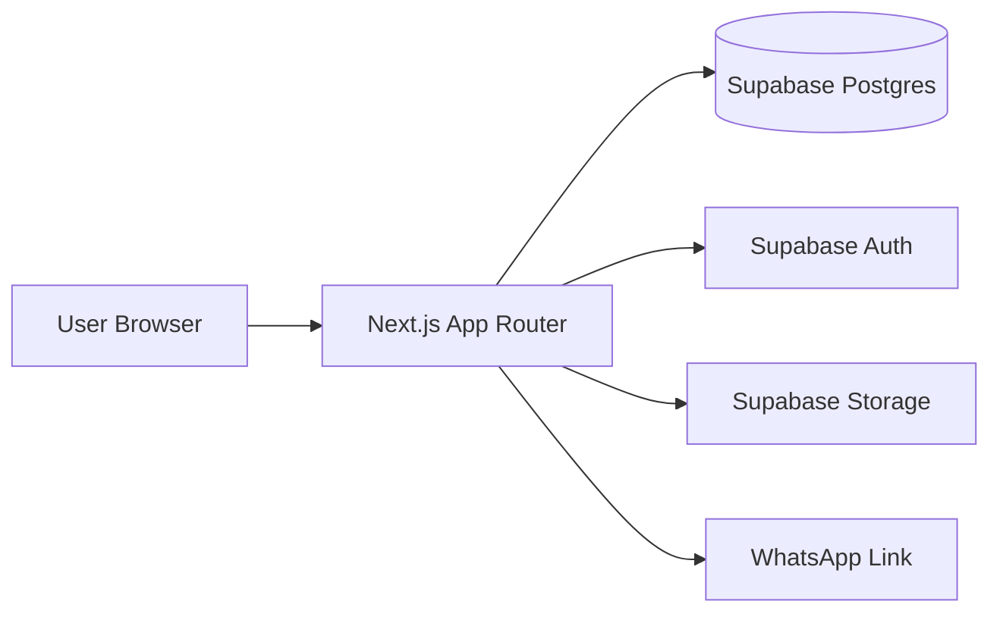
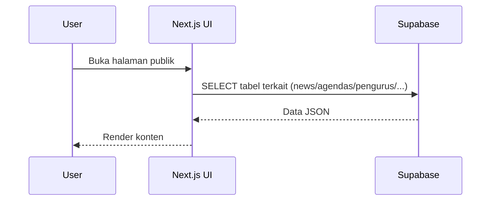
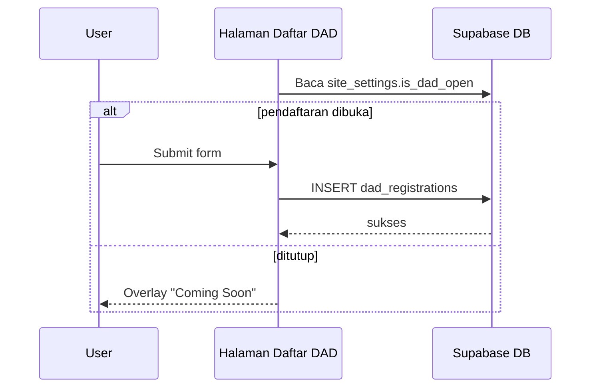
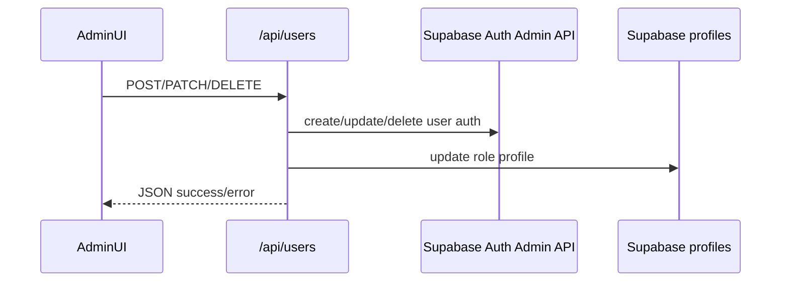

# Design

## 1. Arsitektur Sistem
Aplikasi menggunakan Next.js App Router dengan pendekatan hybrid:
- **Frontend UI**: React Client Components dominan.
- **Backend internal ringan**: Route handler Next.js hanya untuk manajemen user (`/api/users`).
- **Backend utama**: Supabase (Auth + Postgres + Storage).



## 2. Struktur Folder (Ringkas)
```text
src/
  app/
    (public)/           # halaman publik organisasi
    (admin)/dashboard/  # panel admin dan modul operasional
    api/users/          # internal API users management
    kaizen-company/     # landing & katalog unit bisnis
    login/              # login admin
    lib/data.ts         # data/tipe statis pendukung UI
    layout.tsx          # root metadata + global layout
    robots.ts, sitemap.ts
  components/common/    # Navbar, Footer, Logo
  lib/supabase/         # helper Supabase client/server
  types/database.ts     # placeholder type database
  utils/supabase/       # helper Supabase client tambahan
public/
  img/, video/          # aset statis
```

## 3. Komponen Utama
- **Public module**: beranda, berita, bidang, kepengurusan, alumni, kontak, aspirasi, daftar DAD.
- **Admin module**: dashboard statistik + CRUD berita, agenda, pengurus, bidang, alumni, produk, profil organisasi, verifikasi DAD, triase aspirasi, users.
- **Kaizen Company module**: katalog produk aktif + CTA WhatsApp + info layanan.

## 4. Data Flow

### 4.1 Public content flow


### 4.2 DAD registration flow


### 4.3 Admin user management flow


## 5. Authentication Flow
- Login admin menggunakan `supabase.auth.signInWithPassword`.
- Setelah login, UI menyimpan `isAuthenticated` dan `userRole` di `localStorage`.
- Layout dashboard memeriksa localStorage untuk akses halaman admin.
- Logout memanggil `supabase.auth.signOut()` lalu hapus localStorage.

Catatan: guard server-side route untuk `/api/users` tidak terlihat eksplisit di code.

## 6. Integrasi Eksternal
- **Supabase**: database, auth, storage.
- **WhatsApp deep links**: checkout produk/kontak/kolaborasi.
- **Google Maps Embed**: halaman kontak.
- **PWMU URL**: referensi berita eksternal.

## 7. Konfigurasi Runtime & Deployment yang Terlihat
- Framework: Next.js `16.3.5`.
- React `19.2.8`.
- Styling: Tailwind CSS + global CSS variables.
- Script: `dev`, `build`, `start`, `lint` di `package.json`.
- `next.config.ts` mengizinkan remote image pattern domain Supabase storage.
- Metadata SEO: `layout.tsx`, `robots.ts`, `sitemap.ts`.

## 8. Keputusan Desain yang Terlihat di Implementasi
1. **BaaS-centric**: data akses langsung ke Supabase di client untuk banyak modul.
2. **Single internal API focus**: hanya modul user management memakai route server internal.
3. **Role UI-gated**: menu dashboard difilter berdasarkan role dari localStorage.
4. **Operational logging**: beberapa aksi admin/login dicatat ke `system_logs`.

## 9. Hal yang Belum Dapat Dikonfirmasi
- Skema migration SQL, RLS policy, FK/index di Supabase.
- Deployment target final (mis. Vercel/self-hosted) dari pipeline CI/CD.
- Endpoint `/api/users/status` tidak ditemukan meski dipanggil UI.
