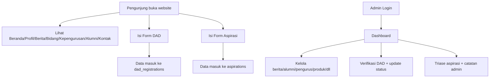

# Product Discovery

## 1. Problem Statement
PK IMM Kaizen membutuhkan kanal digital terpusat untuk:
- publikasi profil, berita, struktur kepengurusan, bidang, alumni, dan kontak,
- pendaftaran DAD secara online,
- penyaluran aspirasi mahasiswa,
- pengelolaan konten melalui dashboard admin,
- etalase bisnis `Kaizen Company`.

Implementasi nyata ditemukan pada route publik/admin di `src/app/(public)/*`, `src/app/(admin)/dashboard/*`, dan `src/app/kaizen-company/page.tsx`.

## 2. Target User / Persona
1. **Pengunjung publik (mahasiswa/umum)**
   - Akses informasi organisasi, berita, bidang, alumni, kontak.
   - Mengisi form aspirasi dan pendaftaran DAD.
2. **Pengurus/Admin IMM Kaizen**
   - Login dashboard.
   - Mengelola data inti (berita, pengurus, alumni, produk, dll).
3. **Calon peserta DAD**
   - Mengirim data pendaftaran via form publik.
4. **Calon pembeli/kolaborator Kaizen Company**
   - Melihat katalog produk dan melakukan checkout/kontak via WhatsApp.

## 3. Jobs-To-Be-Done (JTBD)
- Sebagai pengunjung, saya ingin melihat informasi organisasi terbaru agar memahami aktivitas IMM Kaizen.
- Sebagai calon peserta, saya ingin mendaftar DAD online agar tidak perlu proses manual.
- Sebagai mahasiswa, saya ingin mengirim aspirasi agar masukan saya terdokumentasi.
- Sebagai admin, saya ingin mengelola seluruh konten dari satu dashboard agar operasional cepat.
- Sebagai calon pembeli, saya ingin memesan produk melalui WhatsApp agar transaksi mudah.

## 4. Pain Points yang Ditangani
- Informasi organisasi tersebar/tidak real-time → diatasi dengan data dari Supabase di halaman publik.
- Pengelolaan konten manual → diatasi dashboard CRUD admin.
- Aspirasi sulit ditelusuri → ada status dan catatan admin.
- Pendaftaran DAD perlu kontrol periode → ada flag buka/tutup pendaftaran dari `site_settings`.

## 5. Goals
- Menyediakan portal publik organisasi yang konsisten.
- Menyediakan backoffice admin untuk operasional konten harian.
- Menyediakan alur partisipasi publik (aspirasi, pendaftaran DAD).
- Mendukung unit bisnis organisasi (Kaizen Company).

## 6. Value Proposition
- **Satu platform** untuk publikasi + operasional internal.
- **Data-driven** menggunakan Supabase (bukan konten statis penuh).
- **Aksi cepat**: banyak alur langsung terhubung ke WhatsApp untuk tindak lanjut.

## 7. User Journey (As-Is di Code)

## 8. Asumsi yang Terlihat di Implementasi
- Supabase adalah backend utama (Auth, Database, Storage).
- Otorisasi dashboard berbasis `localStorage` (`isAuthenticated`, `userRole`) di sisi client.
- Sebagian besar akses data dilakukan langsung dari frontend ke Supabase menggunakan anon key.

## 9. Risiko
- Endpoint internal manajemen user menggunakan service role key (`src/app/api/users/route.ts`) tanpa guard autentikasi eksplisit di route.
- Ketidakkonsistenan status aspirasi: form publik mengirim `status: 'unread'`, dashboard admin mengasumsikan `pending|process|resolved`.
- UI pengguna memanggil `/api/users/status`, tetapi route tersebut **tidak ditemukan di repository**.

## 10. Pertanyaan Terbuka
- Skema final tabel Supabase (constraint/index/RLS) tidak ditemukan di repository. **Perlu dikonfirmasi**.
- Mekanisme otorisasi server-side untuk endpoint `/api/users` tidak ditemukan. **Perlu dikonfirmasi**.
- Status valid final untuk modul aspirasi (`unread` vs `pending/process/resolved`) **perlu dikonfirmasi**.
